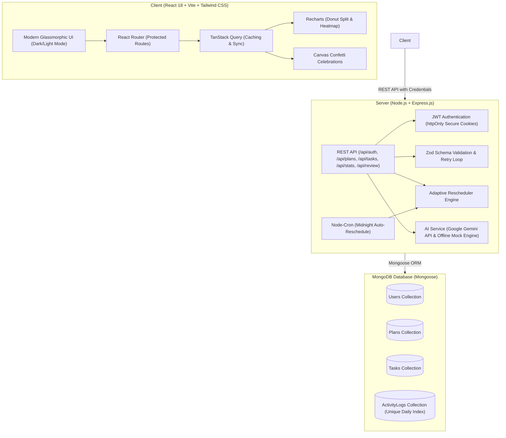

# PrepPath 🧭
### AI-Powered Placement & Skill-Preparation Planner and Tracker

**PrepPath** is a production-grade full-stack MERN application engineered to solve placement and preparation anxiety for students and career switchers. It takes your target role, experience level, and daily availability to generate a structured, day-by-day curriculum with curated resources, tracks your daily momentum with a GitHub/LeetCode-style contribution heatmap, and adaptively reschedules missed tasks so you never fall behind.

---

## 🏗️ System Architecture



---

## ✨ Core Features

1. **AI-Powered Curriculum Generation**:
   - Generates personalized roadmaps validated strictly with **Zod schemas**.
   - Balanced weightage percentages (e.g., Frontend 35%, Backend 30%, Database 15%, DSA & System Design 20%).
   - Multi-phase milestone structure with start/end day boundaries and key learning goals.
   - Day-by-day task lists with estimated minutes and curated learning links.
   - **Deterministic Mock Engine (`MOCK_AI=true`)** provides instant zero-config testing without an API key, and switches seamlessly to live Google Gemini API.

2. **GitHub/LeetCode-Style Contribution Heatmap**:
   - Reusable 12-month calendar matrix (53 weeks × 7 days).
   - Dynamic 5-level green intensity (0-4) based on completed tasks and logged minutes.
   - Interactive hover tooltips showing date, completed task count, and minutes spent.
   - Real-time streaks calculation: Current Streak, Longest Streak, Total Active Days, and Total Hours Logged.

3. **Adaptive Task Rescheduler (Cron & Manual)**:
   - Intelligent redistribution algorithm moves uncompleted tasks from past dates into future days without exceeding the user's daily study hours capacity.
   - Extends plan end date only when upcoming days are fully booked.
   - Runs automatically at midnight via **`node-cron`** (`0 0 * * *`) and is triggerable manually on demand.

4. **Interactive Daily Execution (Today's Tasks)**:
   - Category-grouped checklists with duration estimates and reference links.
   - Atomic sync with `ActivityLog` upon checking/unchecking tasks.
   - Micro-interaction celebration: **Confetti explosion** when all of today's tasks are completed!
   - Modal for creating, editing, and deleting custom tasks.

5. **Weekly AI Mentor Review**:
   - Synthesizes your past 7 days of performance into an executive summary, key wins, gap analysis with severity tags, and high-impact action recommendations.

6. **Modern Aesthetics & Responsive UX**:
   - Tailwind CSS dark and light mode with persistent preference.
   - Glassmorphic card styling, subtle gradients, glowing badges, and mobile-friendly drawer navigation.

---

## 🚀 Quick Start Guide

### Prerequisites
- [Node.js](https://nodejs.org/) v18+ (Tested on v24)
- [MongoDB](https://www.mongodb.com/) running locally on `mongodb://localhost:27017` (or MongoDB Atlas URI)

### 1. Installation

Clone repository and install dependencies:
```bash
# Install root, server, and client dependencies
npm run install-all
```

### 2. Environment Configuration

The backend comes pre-configured with default values in `server/.env.example` and `server/.env`:
```env
PORT=5000
NODE_ENV=development
CLIENT_URL=http://localhost:5173
MONGODB_URI=mongodb://localhost:27017/preppath
JWT_SECRET=super_secret_preppath_jwt_key_987654321
JWT_EXPIRES_IN=7d
MOCK_AI=true
GEMINI_API_KEY=your_gemini_api_key_here
AI_PROVIDER=gemini
```

### 3. Database Seeding (Instant Demo Data)

Seed the database with a demo user, an active 60-day MERN roadmap, and **86 days of realistic activity logs** to populate the heatmap immediately:
```bash
npm run seed
```

**Demo Login Credentials:**
- **Email:** `demo@preppath.dev`
- **Password:** `DemoPassword123!`
*(Or use the 1-click Demo button on the login screen)*

### 4. Running the Application

Run both backend and frontend concurrently with a single command:
```bash
npm run dev
```

- **Frontend:** [http://localhost:5173](http://localhost:5173)
- **Backend API:** [http://localhost:5000](http://localhost:5000)

### 5. Running the Test Suite

Run the full automated unit and end-to-end integration test suite:
```bash
npm run test
```

---

## 📡 REST API Reference

### Authentication (`/api/auth`)
| Method | Endpoint | Description |
| :--- | :--- | :--- |
| `POST` | `/api/auth/register` | Register new account and issue JWT cookie |
| `POST` | `/api/auth/login` | Sign in with email and password |
| `POST` | `/api/auth/logout` | Clear session cookie |
| `GET` | `/api/auth/me` | Fetch authenticated user profile |

### Plans & Roadmaps (`/api/plans`)
| Method | Endpoint | Description |
| :--- | :--- | :--- |
| `POST` | `/api/plans/generate` | Generate AI curriculum and insert tasks |
| `GET` | `/api/plans/active` | Get active roadmap, phases, and stats |
| `PATCH` | `/api/plans/:id` | Update daily hours or archive plan |
| `POST` | `/api/plans/:id/reschedule` | Run adaptive rescheduling for overdue tasks |

### Tasks (`/api/tasks`)
| Method | Endpoint | Description |
| :--- | :--- | :--- |
| `GET` | `/api/tasks?date=YYYY-MM-DD` | Get tasks for date (or date range) |
| `POST` | `/api/tasks` | Create custom task |
| `PATCH` | `/api/tasks/:id` | Toggle task status or edit details |
| `DELETE` | `/api/tasks/:id` | Delete custom task |

### Statistics & Heatmap (`/api/stats`)
| Method | Endpoint | Description |
| :--- | :--- | :--- |
| `GET` | `/api/stats/heatmap?year=YYYY` | 365-day activity matrix (intensity 0-4) |
| `GET` | `/api/stats/summary` | Current streak, longest streak, active days, hours |

### Weekly Review (`/api/review`)
| Method | Endpoint | Description |
| :--- | :--- | :--- |
| `POST` | `/api/review/weekly` | Generate AI summary of past 7 days |

---

## 📂 Project Structure

```
Project-2/
├── client/                     # Vite + React Frontend
│   ├── src/
│   │   ├── api/client.js       # Axios client with credentials
│   │   ├── components/         # Navbar, Heatmap, TaskCard, Modal, Charts...
│   │   ├── context/            # AuthContext, ThemeContext, ToastContext
│   │   ├── pages/              # Landing, Login, Onboarding, Dashboard, Today...
│   │   ├── utils/confetti.js   # Confetti particle burst effect
│   │   ├── App.jsx             # React Router structure
│   │   └── main.jsx            # QueryClient & Context wrappers
│   └── package.json
│
├── server/                     # Express Backend
│   ├── src/
│   │   ├── config/             # MongoDB connection & env loader
│   │   ├── controllers/        # Auth, Plan, Task, Stats, Review controllers
│   │   ├── jobs/cron.js        # Nightly node-cron adaptive rescheduler
│   │   ├── middleware/         # Auth, validation, error handler
│   │   ├── models/             # User, Plan, Task, ActivityLog schemas
│   │   ├── routes/             # Express API routes
│   │   ├── schemas/            # Zod validation schemas
│   │   ├── scripts/seed.js     # Demo user & 90-day heatmap data seed
│   │   ├── services/           # AIService, RescheduleService, StreakService
│   │   ├── tests/              # Unit & End-to-End test suite
│   │   ├── app.js              # Express app configuration
│   │   └── server.js           # Server startup entry point
│   └── package.json
│
├── package.json                # Monorepo scripts
└── README.md
```
